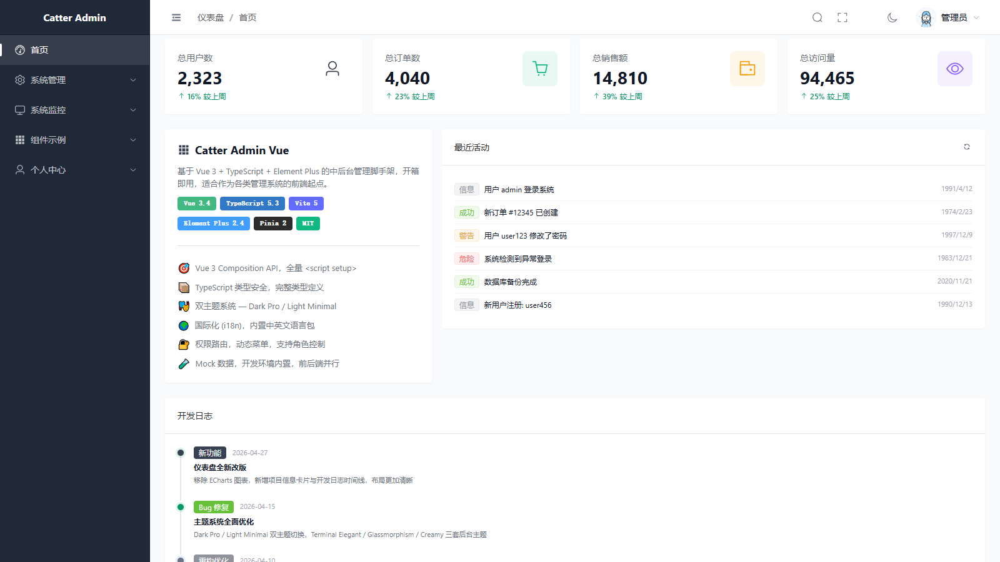
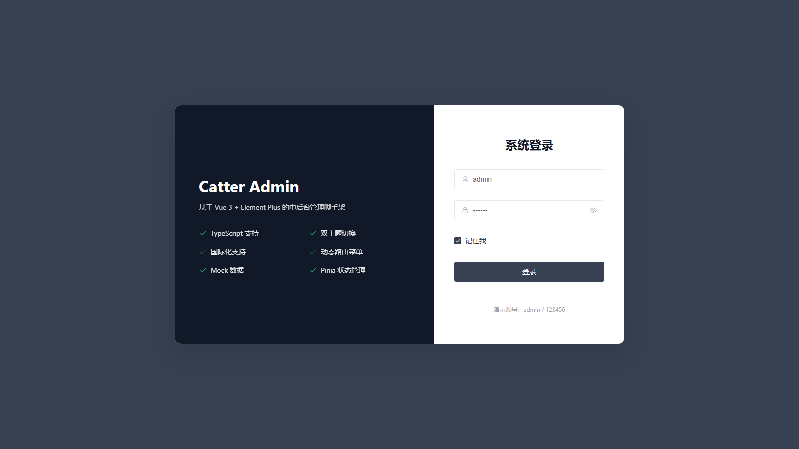
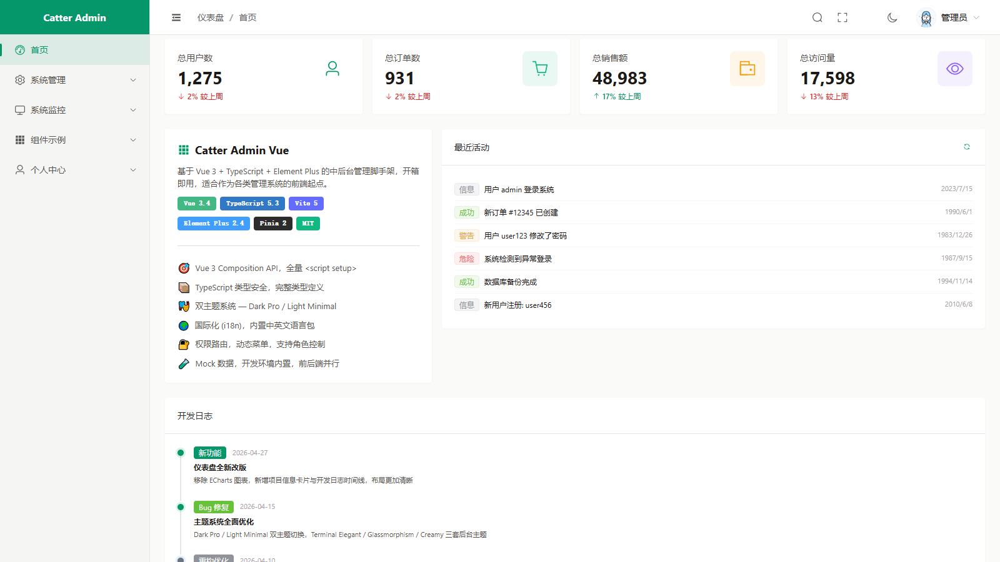
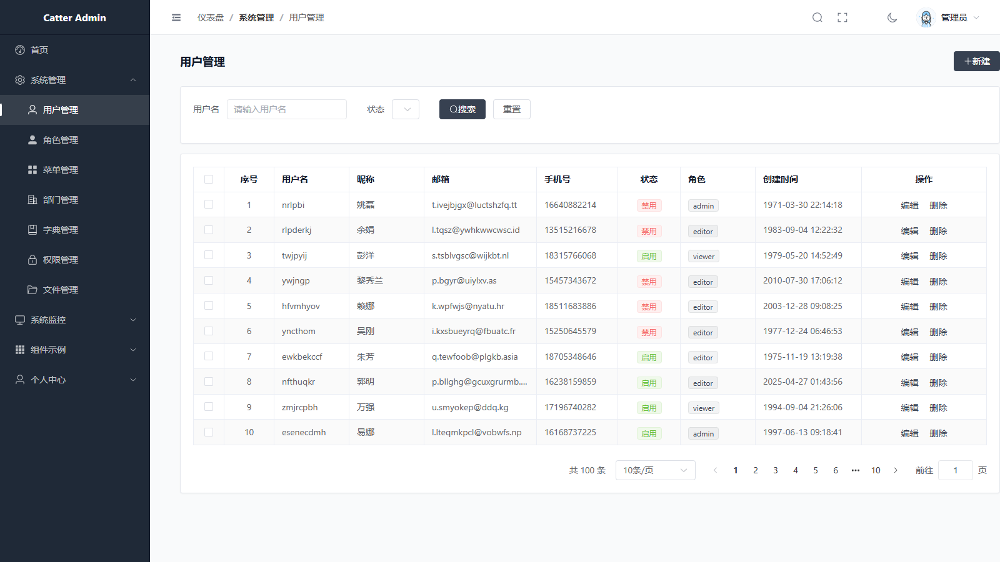
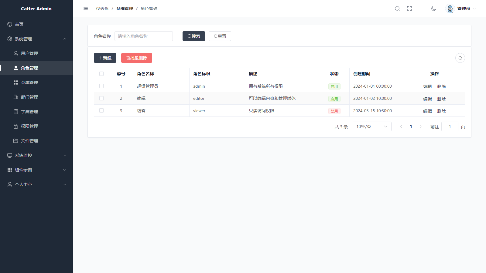
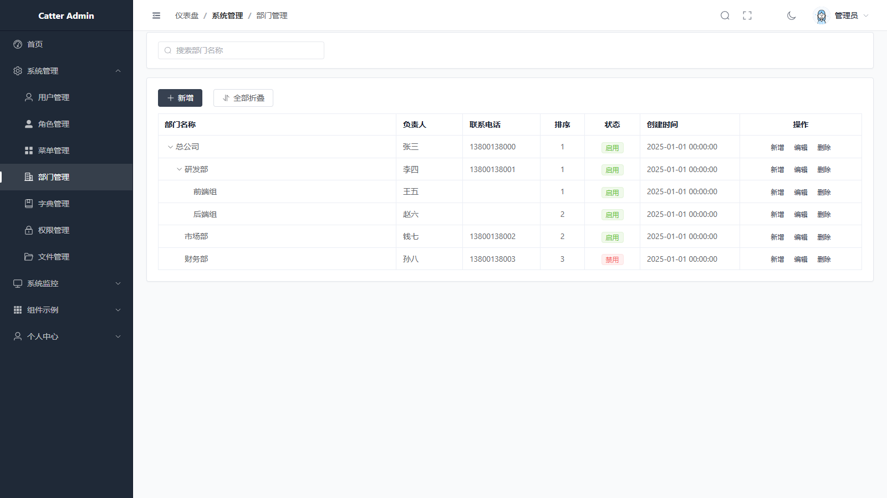
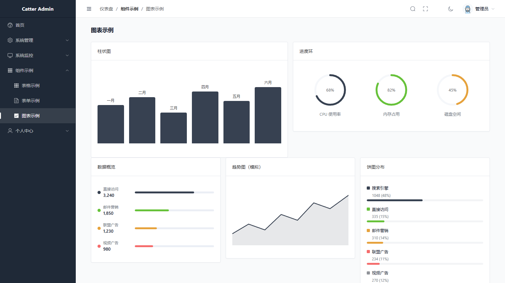
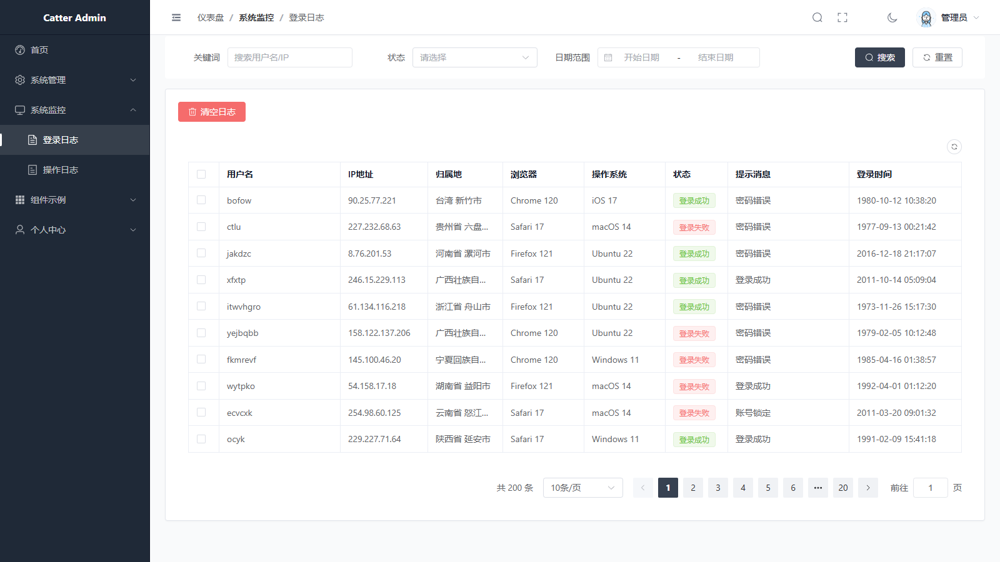

# Catter Admin Vue

<p align="center">
  
  
  
  
  
  
</p>

<p align="center">
  基于 <b>Vue 3 + TypeScript + Element Plus</b> 的中后台管理脚手架<br/>
  <sub>动态菜单 · 按钮级权限 · 双主题 · 国际化 · Mock 数据 · 开箱即用</sub>
</p>

---

## 简介

**Catter Admin Vue** 是一套可直接作为项目起点的中后台前端脚手架。它不是"组件堆砌 demo"，而是一条完整可用的链路：登录 → 拉取用户信息 → 按角色生成菜单与动态路由 → 页面内按权限码控制按钮 → 令牌过期自动清理会话并回跳登录页。

所有页面均已接入 axios 封装、统一错误提示、分页/筛选/表单校验与二次确认，开发环境内置 Mock，前后端可并行开发。

> 下面所有截图均由本项目在本地实际运行后截取，非设计稿。

---

## 界面预览

<p align="center">
  
</p>
<p align="center"><sub>仪表盘 · Dark Pro 主题</sub></p>

| 登录页 | 仪表盘 · Light Minimal |
| :---: | :---: |
|  |  |

| 用户管理 | 角色管理（按钮级权限） |
| :---: | :---: |
|  |  |

| 部门管理（树形表格） | 图表示例（ECharts） |
| :---: | :---: |
|  |  |

<p align="center">
  
</p>
<p align="center"><sub>系统监控 · 登录日志（筛选 / 分页 / 批量删除确认）</sub></p>

---

## 特性

| | 特性 | 说明 |
| :---: | :--- | :--- |
| 🔐 | **动态菜单 + 动态路由** | 菜单来自 `/api/menus`，运行时生成路由；路由名统一加 `menu_` 前缀并去重，避免与静态路由冲突 |
| 🛡 | **按钮级权限** | `v-permission` 指令，支持权限码数组、`*` 通配与 `:disabled` 模式，权限异步加载后可响应式恢复 |
| 🔁 | **会话生命周期** | 登录态持久化（记住我 → localStorage / 否则 sessionStorage）、401 自动清理并携带回跳地址、登出清理菜单与路由 |
| 🎨 | **双主题** | Dark Pro / Light Minimal，CSS 变量驱动，切换持久化 |
| 🌍 | **国际化** | vue-i18n 中英文，Element Plus 内置文案同步切换 |
| 📡 | **请求封装** | axios 拦截器统一处理业务码、401/403 分流、超时与网络错误提示 |
| 🧩 | **业务组件** | `ProTable`（列显隐/拖拽排序/分页）、`SearchForm`（可折叠查询区）、`FileUpload` / `ImageUpload`（类型与大小校验）、`TreeSelect`、`VChart` |
| 🧪 | **Mock 服务** | vite-plugin-mock，开发环境自动启用，生产构建不打包 |
| 📐 | **工程规范** | TypeScript 严格模式、ESLint、Prettier，`vue-tsc` 类型检查通过 |

---

## 技术栈

| 类别 | 技术 | 版本 |
| :--- | :--- | :--- |
| 框架 | [Vue](https://vuejs.org/) | ^3.4（当前安装 3.5.x） |
| 语言 | [TypeScript](https://www.typescriptlang.org/) | ^5.3 |
| UI 库 | [Element Plus](https://element-plus.org/) | ^2.6（当前安装 2.13.x） |
| 构建 | [Vite](https://vitejs.dev/) | ^5.0 |
| 状态管理 | [Pinia](https://pinia.vuejs.org/) | ^2.1 |
| 路由 | [Vue Router](https://router.vuejs.org/) | ^4.2 |
| HTTP | [Axios](https://axios-http.com/) | ^1.6 |
| 国际化 | [vue-i18n](https://vue-i18n.intlify.dev/) | ^9.8 |
| 图表 | [ECharts](https://echarts.apache.org/) | ^6.0 |
| Mock | [vite-plugin-mock](https://github.com/vbenjs/vite-plugin-mock) | ^3.0 |
| 工具库 | [@vueuse/core](https://vueuse.org/) | ^10.7 |

---

## 快速开始

### 环境要求

- Node.js >= 18
- npm >= 9（或 pnpm >= 8）

### 安装与启动

```bash
npm install        # 安装依赖
npm run dev        # 启动开发服务器 → http://127.0.0.1:5173
```

开发服务器默认只监听本机。若需要手机等设备联调，设置环境变量 `VITE_HOST=true` 后再启动（会监听 `0.0.0.0`，请确认所处网络可信）。

### 常用命令

| 命令 | 说明 |
| :--- | :--- |
| `npm run dev` | 启动开发服务器（含 Mock） |
| `npm run build` | 类型检查 + 生产构建，产物在 `dist/` |
| `npm run preview` | 本地预览构建产物 |
| `npm run type-check` | 仅执行 `vue-tsc --noEmit` |
| `npm run lint` | ESLint 检查（`npm run lint:fix` 自动修复） |
| `npm run format` | Prettier 格式化 `src/` |

### 演示账号

> **`admin` / `123456`**

演示账号仅在开发环境（`import.meta.env.DEV`）预填与展示，生产构建不会出现。Mock 登录是**假认证**，请勿据此评估安全性，详见[已知限制](#-已知限制)。

---

## 🔐 权限模型

### 路由级

登录后由路由守卫统一 bootstrap：

```text
token 是否存在
  └─ 否 → 白名单？放行 : 跳转 /login?redirect=<fullPath>
  └─ 是 → 用户信息是否已加载？
        └─ 否 → GET /api/auth/user
        └─ 加载菜单 GET /api/menus → 生成动态路由 → 注入角色/权限 → 兜底 404
```

动态路由的组件通过白名单映射（`src/router/index.ts` 的 `componentMap`）解析，后端若返回未登记的组件路径会落到 404 页并打印警告，而不是拼接任意模块路径。

### 按钮级

```vue
<!-- 无权限则隐藏 -->
<el-button v-permission="['system:role:add']" type="primary">新建</el-button>

<!-- 无权限则禁用 -->
<el-button v-permission:disabled="['system:role:del']" type="danger">删除</el-button>
```

- 权限码来自 `GET /api/auth/user` 返回的 `permissions` 数组；
- `'*'` 表示超级权限，所有判定直接放行；
- 指令会监听权限变化，异步加载完成后自动恢复显示，不需要刷新页面。

组合式用法：

```ts
const { hasPermission, hasRole, isAdmin } = usePermission()
if (hasPermission('system:user:del')) { /* ... */ }
```

---

## 🎨 主题系统

| 主题 | 说明 | 特点 |
| :--- | :--- | :--- |
| **Dark Pro** | 默认 | 深灰侧边栏 + 浅灰白内容区，克制的灰阶层次 |
| **Light Minimal** | 浅色 | 奶白侧边栏 + 绿色主色，适合长时间阅读 |

右上角下拉切换，选择持久化到 `localStorage`。主题完全由 CSS 变量驱动，编辑 `src/styles/variables.css` 即可定制：

```css
:root[data-admin-theme='light'] {
  --admin-primary: #059669;   /* 主色 */
  --admin-bg-page: #FAFAF9;   /* 页面底色 */
  --admin-sidebar-bg: #F5F5F4;
}
```

---

## 🌍 国际化

- 语言包：`src/locales/lang/zh-CN.ts`、`en-US.ts`（两侧键集合保持一致）；
- 切换语言时 Element Plus 的分页、日期选择器文案也会同步（`el-config-provider`）；
- 新增语言：在 `lang/` 下新建文件并在 `src/locales/index.ts` 注册，然后在 Header 下拉里加一项。

```ts
const messages = {
  'zh-CN': zhCN,
  'en-US': enUS,
  'ja-JP': jaJP,
}
```

---

## 🔄 动态菜单

```ts
interface Menu {
  id: number
  name: string        // 路由名（会加 menu_ 前缀）
  path: string        // 必须以 / 开头
  component?: string  // 'system/user/index'，需在 componentMap 中登记
  icon?: string       // Element Plus 图标名
  title: string       // 菜单标题
  hidden?: boolean
  keepAlive?: boolean
  parentId?: number
  permission?: string // 可选：用于推导权限码
  children?: Menu[]
}
```

一级菜单若本身是页面（如首页），会作为 Layout 的子路由；有 `children` 的分组只展开其子项。标签页「刷新」依赖隐藏路由 `/redirect/:path(.*)`，由脚手架自动注册。

---

## 📡 接口约定

### 响应结构

```ts
interface ApiResponse<T> {
  code: number     // 0 或 200 视为成功
  message: string
  data: T
}
```

拦截器行为：

| 情况 | 处理 |
| :--- | :--- |
| `code` 非 0/200 | 弹出 `message` 并 reject |
| `code` 或 HTTP 401 | 清理会话 → 跳转 `/login?redirect=<当前地址>` |
| HTTP 403 | 仅提示"没有权限访问"，**不登出** |
| 超时 `ECONNABORTED` | 提示"请求超时" |
| 无响应 | 提示"无法连接到服务器" |

### 环境变量

| 变量 | 说明 | 默认值 |
| :--- | :--- | :--- |
| `VITE_API_BASE_URL` | 接口基础地址 | 空（同源，走 `/api`） |
| `VITE_HOST` | 设为 `true` 时开发服务器监听 `0.0.0.0` | 未设置（仅本机） |

创建 `.env.development` / `.env.production` 覆盖：

```env
VITE_API_BASE_URL=https://api.your-domain.com
```

### 关闭 Mock / 对接真实后端

在 `vite.config.ts` 中把 `enable` 置为 `false`（vite-plugin-mock v3 的开关是 `enable`，不是 `localEnabled`）：

```ts
viteMockServe({ mockPath: 'src/mock', enable: false })
```

注意 Mock 的路由顺序：`/api/xxx/batch`、`/api/xxx/clean` 这类**静态路由必须写在 `:id` 之前**，否则会被参数路由匹配掉。

---

## 📁 目录结构

```text
catter-admin-vue/
├── docs/screenshots/          # README 截图
├── public/                    # 静态资源（favicon 等）
├── src/
│   ├── api/                   # 接口定义（auth/user/menu/role/dept/dict/log/file/permission/dashboard）
│   ├── components/
│   │   ├── common/            # ProTable / SearchForm / TreeSelect / FileUpload / ImageUpload / VChart
│   │   └── layout/            # AppLayout / Header / Sidebar / TagsView
│   ├── composables/           # useTable / useCrud / useModal / useSelection / useDict / useTree / usePermission
│   ├── directives/            # v-permission / v-debounce / v-throttle / v-longpress / v-copy
│   ├── locales/               # i18n 入口与语言包
│   ├── mock/                  # 开发环境 Mock（生产不打包）
│   ├── router/index.ts        # 路由守卫 + 动态路由
│   ├── store/modules/         # user / app / permission
│   ├── styles/                # 主题变量与全局样式
│   ├── utils/                 # request / session / export / download / validate / storage / format
│   └── views/                 # dashboard / login / system / monitor / components / profile / error / redirect
├── .eslintrc.cjs
├── index.html
├── tsconfig.json
└── vite.config.ts
```

---

## 🚢 部署

```bash
npm ci
npm run build      # 产物：dist/
```

### Nginx

```nginx
server {
    listen 80;
    server_name your-domain.com;

    root /var/www/catter-admin/dist;
    index index.html;

    # SPA 路由 fallback（刷新子路由必需）
    location / {
        try_files $uri $uri/ /index.html;
    }

    # 接口反向代理（可选）
    location /api {
        proxy_pass http://backend:8080;
        proxy_set_header Host $host;
        proxy_set_header X-Real-IP $remote_addr;
    }

    # 静态资源长缓存
    location ~* \.(js|css|png|jpg|jpeg|gif|ico|svg|woff|woff2|ttf)$ {
        expires 30d;
        add_header Cache-Control "public, immutable";
    }
}
```

> 若部署在子路径（如 `/admin/`），需要同步修改 `vite.config.ts` 的 `base` 并重新构建。

### Docker

```dockerfile
FROM nginx:alpine
COPY dist/ /usr/share/nginx/html/
COPY nginx.conf /etc/nginx/conf.d/default.conf
EXPOSE 80
```

```bash
docker build -t catter-admin .
docker run -d -p 80:80 catter-admin
```

### 上线检查清单

- [ ] `npm run build` 无报错（含类型检查）
- [ ] 已配置 `VITE_API_BASE_URL` 与后端 CORS
- [ ] Nginx 配置了 `try_files`，子路由刷新不 404
- [ ] 已开启 HTTPS，并为令牌配置合适的存储方式（见下节）
- [ ] 生产环境已关闭 Mock（`enable: false`）
- [ ] `deploy/` 等本地构建产物未提交（已在 `.gitignore` 中忽略）

---

## 🩺 质量保障

```bash
npm run type-check   # vue-tsc --noEmit
npm run lint         # ESLint（含 .vue）
npm run build        # 构建
```

当前基线：类型检查 0 error、ESLint 0 error / 0 warning、生产构建成功。

一次完整的代码审查（37 项缺陷与安全加固、修复方式、验证过程、遗留风险）见 **[AUDIT-REPORT.md](AUDIT-REPORT.md)**。

---

## ⚠️ 已知限制

1. **Mock 认证是假的**：`admin/123456` 硬编码，签发的 `mock_token_<时间戳>` 不会被校验，任意 token 均可通过。仅用于本地开发。
2. **令牌存储**：存放在 Web Storage（记住我 → localStorage，否则 sessionStorage），可被 XSS 读取；`index.html` 目前未配置 CSP。生产建议改为 httpOnly + SameSite Cookie，并补充 `default-src 'self'` 级别的 CSP。
3. **Element Plus 引入方式**：全量 `app.use(ElementPlus)` 与按需 resolver 并存，存在重复样式（约 367KB CSS）。移除任一侧都可能影响命令式组件与模板类型推导，需单独重构并回归。
4. **占位实现**：个人设置的保存/头像上传、组件示例页的筛选按钮、首页「开发日志」中文文案仍是脚手架占位，未接后端。
5. **未覆盖端到端测试**：现有验证为类型检查 + ESLint + 构建 + 接口冒烟，建议补充 Playwright 用例覆盖"登录 → 刷新 → 401 → 重新登录"链路。

---

## ❓ 常见问题

**端口被占用？**
使用 `npm run dev -- --port 5174`，或修改 `vite.config.ts` 的 `server.port`。

**接口 404 / 网络错误？**
Mock 未命中时会走 `/api` 代理到 `localhost:3000`。检查 `src/mock` 是否声明了该路径，或调整代理目标。

**为什么 403 不退出登录？**
403 表示"已登录但无权限"，强制登出会让用户困惑；只有 401（凭证失效）才清理会话。

**切换语言后 Element Plus 仍是中文/英文？**
语言由 `App.vue` 的 `el-config-provider` 统一注入，确认 `locale` 值属于已注册的语言包。

---

## 📄 License

[MIT](LICENSE)
